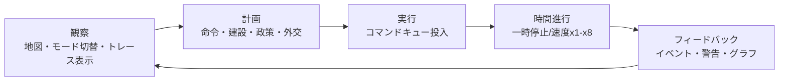
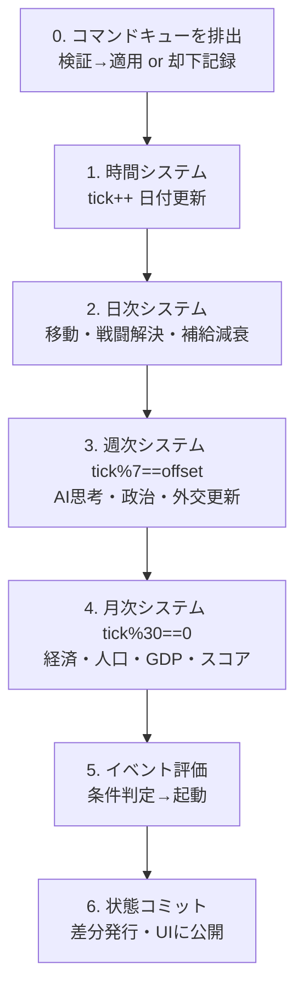

# 04. コアゲームループ

- 作成日: 2026-11-14
- 状態: 確定（Phase 0 成果物 5/18）

## 1. プレイヤーのゲームループ



- **観察**: 世界地図が主画面。表示モード切替、プロヴィンス/国家/部隊の選択、ツールチップで計算根拠を確認。
- **計画**: コマンド（部隊命令・建設・政策・外交提案）を作成。コマンドは検証を経てキューに積まれる。
- **実行**: 時間を進めるとコマンドが tick 境界で適用される。一時停止中でもコマンド投入は可能（適用は次の進行時）。
- **時間進行**: 速度 ×1（1日/秒）・×2・×4・×8、一時停止。重要イベント時は自動一時停止（設定可）。
- **フィードバック**: イベントモーダル・警告フィード（優先度順）・スコア/指標のグラフ。

## 2. エンジンの1Tickパイプライン



- コマンドは tick の最初に適用される（同一tick内での順序依存を防ぐ）。
- 週次・月次システムは `tick % N == hash(システム名) % N` のオフセットで時間分散させる（同tick集中回避）。
- AIは国家ごとに独立のスケジュールを持ち、1週の間に国家を分散して思考する（250国家では1tickあたり数国のみ）。
- UIは rAF 周波数で最新の公開状態を読むだけ（描画とシミュの完全分離、docs/08）。

## 3. AIのゲームループ（他国）

```
週次: 国家状況評価 → 戦略スタンス決定(Utility)
   ├→ 経済AI: 建設優先度 → 建設コマンド
   ├→ 研究AI: 技術選択 → 研究コマンド
   ├→ 外交AI: 提案評価・発案 → 外交コマンド
   └→ 軍事AI: 戦線割当・攻勢判断 → 軍事コマンド
日次: 戦術AI（戦闘中の増援・撤退判断）
```

- プレイヤーと同一のコマンド・同一シミュレーション（チートなし原則）。
- すべての判断は判断ログ（選択肢・スコア・理由）に記録。

## 4. 時間と一時停止の詳細仕様

| 速度 | 目標レート | 用途 |
| --- | --- | --- |
| 一時停止 | 進行なし（命令のみ可） | 計画立案 |
| ×1 | 1日/1秒 | 細部確認・戦争中 |
| ×2 | 2日/秒 | 通常運営 |
| ×4 | 4日/秒 | 平時 |
| ×8 | 8日/秒 | 安定期 |

- 実レートは tick 処理時間が予算（16ms）を超えた場合に自動抑制され、UIに「処理遅延」警告を出す（未計測の性能を保証しないための設計、docs/13）。
- 重要イベント（宣戦・講和提案・政治危機）は自動一時停止（設定で無効化可）。

## 5. セッションループ（メタループ）

タイトル → シナリオ選択 → 国家選択 → ゲーム → セーブ/ロード（いつでも） → リプレイ閲覧（Phase 5）→ タイトルへ。

- セーブは「いつでも」（一時停止不要）。自動セーブは毎ゲーム月＋手動スロット10。
- ゲーム終了条件: シナリオ終了年・勝利条件達成・国家消滅・プレイヤー降伏。
