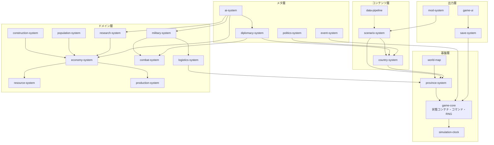

# 06. システム間依存関係

- 作成日: 2026-11-14
- 状態: 確定（Phase 0 成果物 7/18）
- 原則: **下位層は上位層を知らない**。横断的な結合（例: 経済が外交を直接参照する）は禁止し、イベント機構（event-system）が横断的影響を運ぶ。

## 1. 依存グラフ

## 2. 層と依存の規則

| 層 | システム | 依存してよい相手 | 依存禁止 |
| --- | --- | --- | --- |
| 基盤 | clock, game-core, world-map, province-system | 同層内のみ | すべての上位層 |
| コンテンツ | scenario, country, data-pipeline | 基盤層 | ドメイン・メタ層 |
| ドメイン | economy, resource, production, construction, population, military, combat, logistics, research | 基盤・コンテンツ層＋ドメイン内の明示依存 | メタ層（diplomacy/politics/ai/event）|
| メタ | diplomacy, politics, ai, event | 基盤・コンテンツ・ドメイン層 | （aiはドメインの読み取りのみ。状態はコマンド経由で変更）|
| 出力 | save, ui, mod | すべての読み取り | シミュ状態の直接変更（UIはコマンドのみ）|

**重要な規則（不変条件 INV-3）**: AIとUIは状態を直接書き換えない。すべてコマンドを通す。これにより決定論・リプレイ・将来マルチが保証される。

## 3. システム間の主要インタラクション（双方向の整理）

| 依存元 → 先 | 内容 | 方向 |
| --- | --- | --- |
| combat → military | 戦闘結果（損耗・撤退）を師団状態へ反映 | 一方向（戦闘は軍事状態を書き換える） |
| military → logistics | 移動・駐留の補給要求 | 一方向（logisticsは供給効率を返す） |
| logistics → province | infra損壊の反映（占領・破壊時） | 一方向 |
| economy ↔ population | 建物は労働を需要、popは賃金・財を消費 | 双方向（ただし同一tick内の更新順序は固定: pop雇用 → 生産 → 消費） |
| diplomacy → combat | 停戦・講和で戦闘停止 | コマンド経由 |
| event → 全システム | 効果はコマンド列として発行 | コマンド経由 |
| research → economy/military | 技術効果（修飾子・解禁） | 修飾子マップの参照（書き換えなし） |
| ai → 全ドメイン | 評価（読み取り）＋コマンド発行 | 読み取り＋コマンド |

## 4. 初期化順序（起動時）

1. mod-system → シナリオパックの列挙と検証
2. scenario-system → パックのロード・バリデーション（ジオメトリ・ID・統計整合）
3. province/country stores 初期化 → 隣接グラフ構築
4. ドメインシステム初期化（市場・pop・軍事・補給グラフの構築）
5. メタ層初期化（関係値・政体・イベントキュー）
6. clock 開始（シナリオ開始日・シード適用）

## 5. 更新順序（tick内、固定・決定論的）

1. コマンド適用（検証順: 受信順・FIFO）
2. 時間進行
3. 日次: 移動 → 戦闘 → 補給減衰適用
4. 週次（オフストリーム）: AI思考 → 政治更新 → 外交更新
5. 月次: 雇用 → 生産 → 消費 → 貿易 → 価格更新 → 人口成長 → GDP/スコア集計
6. イベント評価
7. 状態コミット・差分公開

同一tick内のこの順序はエンジンの不変条件とし、システムの追加はスケジューラの登録順で決まる（挿入順序の自由は持たせない）。
