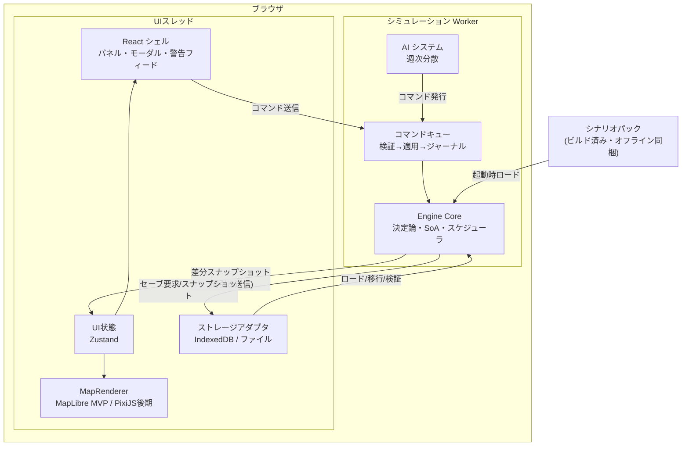
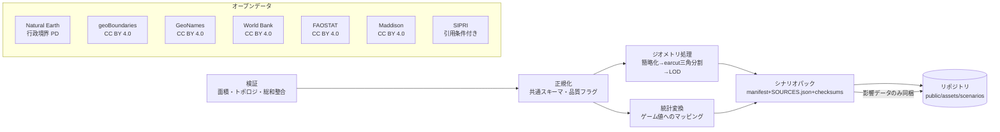
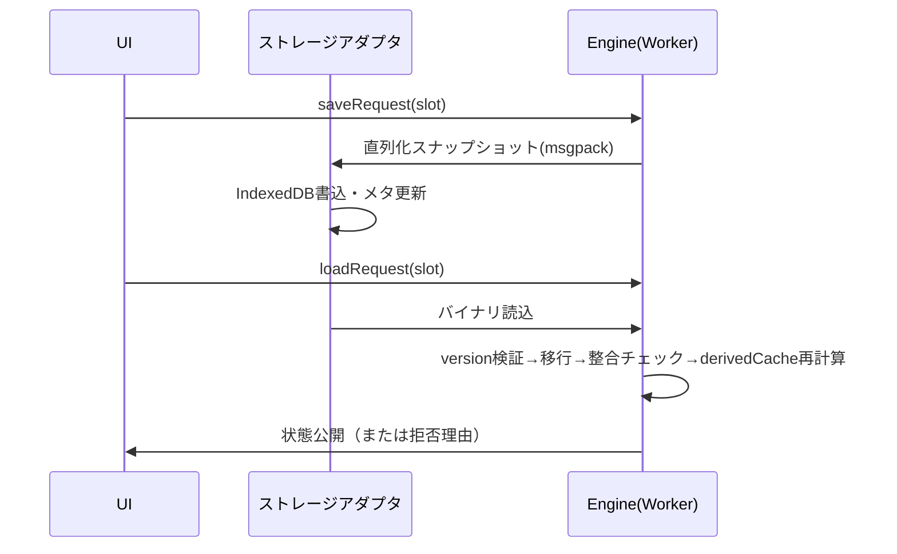

# 10. アーキテクチャ図

- 作成日: 2026-11-14
- 状態: 確定（Phase 0 成果物 11/18）

## 1. 全体アーキテクチャ（ランタイム）



- UIとエンジンは Worker 境界で完全分離。共有は①コマンド（上り）②差分スナップショット（下り）③トレース要求/応答（オンデマンド）。
- シナリオパックはビルド時に `tools/pipeline` が生成し、ゲームに同梱（ランタイム外部API呼び出しゼロ）。

## 2. データパイプライン（ビルド時）



- ライセンスが厳しいデータ（UN Comtrade・SIPRIのフルセット）は**生データを同梱しない**。加工後のゲーム値のみ同梱し、出典をクレジット画面に表示する（docs/12）。

## 3. モジュール依存（パッケージ視点）

```text
@orbis/engine  （決定論コア。Node/Worker両対応。UI非依存）
    ↑        ↑
@orbis/data   @orbis/maprender   （シナリオ型定義・バリデータ / 地図抽象）
    ↑              ↑
    └──── @orbis/app  ────（Viteアプリ: React + MapLibre + Worker起動）
                ↑
           @orbis/bench  （Nodeベンチマークハーネス。appを介さずengineを直接実行）
```

- エンジンは `@orbis/engine` 単一パッケージに閉じ、OpenFrontの「決定論シミュの独立パッケージ化」を踏襲する。
- Phase 1 は単一リポジトリのモジュラーモノリス（npm workspaces）とし、パッケージ分割は論理的境界のみ（物理ビルド分割は不要）。

## 4. セーブ/ロードのフロー



## 5. 決定論の保証レーン

```text
シード → PCG32(世界ストリーム + システム派生ストリーム)
コマンド → FIFO適用（uid二重適用防止）
反復 → ID順固定
数値 → float64仕様確定演算のみ / 超越関数禁止 / LUT補間
検証 → ハッシュアンカー(月末) + リプレイ二重実行 + セーブ/ロード一致テスト
```

## 6. 性能のための構造的決定

- 差分レンダリング: エンジン→UIは「変更ストア範囲」のみ送信。MapRendererは dirty プロヴィンスのみ再配色（feature-state更新 / 頂点カラー更新）。
- 更新制御: cadence（日/週/月）＋オフセット分散＋戦争関与フィルタ＋dirtyフラグ（docs/08 §3）。
- LOD: ジオメトリを3段階で同梱、ズーム帯で切替。ラベルはLOD連動の表示閾値。
- 20kプロヴィンス×100kユニットは**設計目標**であり、MVP必須規模ではない。docs/13 の実測計画に従い、目標は測定後に確定する。
